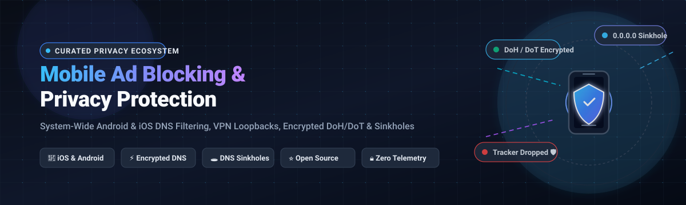

# Awesome-Mobile-Ad-Blocking-Privacy-Protection

<p align="center">
  
</p>

<p align="center">
  <a href="https://github.com/ishandutta2007/Awesome-Awesome-Awesome"></a><a href="https://discord.gg/jc4xtF58Ve"></a>
  <a href="https://github.com/ishandutta2007/Awesome-Mobile-Ad-Blocking-Privacy-Protection/stargazers"></a>
  <a href="https://github.com/ishandutta2007/Awesome-Mobile-Ad-Blocking-Privacy-Protection/network/members"></a>
  <a href="https://github.com/ishandutta2007/Awesome-Mobile-Ad-Blocking-Privacy-Protection/blob/main/LICENSE"></a>
  <a href="https://github.com/ishandutta2007"></a>
</p>

---

## 📱 Top Mobile Ad Blocking & Privacy Protection Ecosystem

**A Curated Showcase of System-Wide Android/iOS DNS & VPN Ad Blockers, Encrypted DNS (DoH/DoT/DoQ), Self-Hosted Sinkholes, Mobile Content Blockers & Curated Filter Lists**  
*Comprehensive security and telemetry auditing benchmark — Updated November 2026*

Welcome to the definitive, SEO-optimized directory and knowledge base dedicated to **Mobile Ad Blocking & Privacy Protection**. Modern mobile applications and mobile web pages embed invasive third-party ad exchanges, analytics SDKs, device fingerprinting scripts, and location telemetry beacons. 

This repository consolidates both **commercial SaaS/hosted DNS privacy platforms** and **peerless open-source utilities** that protect Android and iOS devices using:
* 🌐 **Encrypted Cloud DNS Resolvers**: DNS-over-HTTPS (`DoH`), DNS-over-TLS (`DoT`), and DNS-over-QUIC (`DoQ`).
* 🔄 **Local Loopback VPN Firewalls**: Intercepting and inspecting DNS packets on non-rooted Android and iOS devices.
* 🛡️ **Self-Hosted Network DNS Sinkholes**: Null-routing ad/malware requests at home or in WireGuard tunnels.
* 🧩 **Safari Content Blocker Engines & Hardened Mobile Browsers**: Declarative rule filtering without tracking browsing activity.

---

## 📑 Table of Contents
- [📊 Sector Overview & Market Dynamics](#-sector-overview--market-dynamics)
- [☁️ SaaS & Hosted Platforms](#️-saas--hosted-platforms)
- [💻 Open-Source GitHub Projects](#-open-source-github-projects)
- [⚙️ Architectural Approaches Comparison](#️-architectural-approaches-comparison)
- [🤝 How to Contribute](#-how-to-contribute)
- [💖 Support & Sponsorship](#-support--sponsorship)
- [📈 Star History](#-star-history)
- [⚠️ Disclaimer](#️-disclaimer)

---

## 📊 Sector Overview & Market Dynamics

The global consumer privacy software and ad-blocking market is estimated at **$1.8 billion to $2.4 billion**, expanding at a compound annual growth rate (CAGR) of ~14–17% driven by escalating mobile telemetry concerns, cross-app tracking restrictions (such as Apple ATT), and intrusive programmatic mobile advertisements. 

The sector exhibits **moderate fragmentation with dual concentration dynamics**: consumer mass-market browser and VPN-bundled blocking is concentrated among multi-billion cybersecurity vendors and platforms (Brave, Proton, Mullvad), while specialized system-wide mobile DNS filtering remains moderately fragmented with leading technical innovators (NextDNS, Control D, AdGuard) competing alongside community-driven, self-hosted open-source DNS sinkhole solutions.

---

## ☁️ SaaS & Hosted Platforms

The following table compares leading commercial and hosted mobile ad-blocking services. Products are sorted in descending order by **Company Scale (Estimated Annual Revenue / Valuation)**.

| 🏢 Platform / Service | 💰 Starting Tier Pricing | 🎁 Free Tier Limit / Trial Duration | 📈 Company Scale (Est. Rev / Valuation) | 🛡️ Key Mobile Protection Features |
| :--- | :--- | :--- | :--- | :--- |
| **[Brave Browser & Firewall + VPN](https://brave.com)** | **$9.99/mo** (or $99.99/yr for Firewall + VPN) | **Free Forever**: Built-in Brave Shields (unlimited ad/tracker/fingerprint blocking in browser); 7-day free trial for system-wide VPN | **~$100M+ ARR / ~$1.5B+ Valuation** | Built-in Rust-based adblock engine, mobile shields, native cross-app mobile firewall & VPN tunnel. |
| **[Proton VPN (NetShield Ad-Blocker)](https://protonvpn.com)** | **€9.99/mo** (or €4.99/mo billed 2-yr) | **Free Forever**: 1 device, medium speed, unlimited data, but NetShield ad/tracker blocker is exclusive to paid tiers | **~$80M–$100M ARR / ~$1B Valuation** | High-speed encrypted VPN with DNS-level NetShield ad, malware, and tracker blocking for iOS & Android. |
| **[Total Adblock](https://totaladblock.com)** | **$29.00/yr** (~$2.42/mo for first year, renewing at $99/yr) | **7-Day Free Trial** on mobile apps (full access), plus limited free browser extension blocking top 15,000 trackers | **~$40M–$60M ARR (Total Security Ltd)** | System-wide iOS Safari content blocker and Android app filtering display ads, video ads, and pop-ups. |
| **[Mullvad DNS](https://mullvad.net)** | **€5.00/mo** (flat rate for complete VPN service) | **Free Forever**: Public Encrypted DNS (`DoH`/`DoT`) with ad/tracker/malware blocking is 100% free with no account required | **~$20M–$30M ARR (Mullvad Group)** | No-logging, zero-data-retention public encrypted DNS profiles with tailored ad, tracker, and malware blocking. |
| **[AdGuard DNS & AdGuard Pro](https://adguard-dns.io)** | **$1.66/mo** ($19.99/yr Personal Plan) | **Free Forever**: Up to 300,000 DNS queries/month, 5 devices, and 2 servers on AdGuard DNS Starter plan | **~$15M–$25M ARR** | System-wide HTTPS filtering, DNS-over-QUIC, Safari content blocker, and customizable ad/tracker filters. |
| **[Control D](https://controld.com)** | **$2.00/mo** ($20/yr Some Control Plan; $4/mo Full Control) | **30-Day Free Trial** for Full Control plan (no credit card required); Free public uncached DNS resolvers | **~$3M–$7M ARR (Windscribe Parent)** | Granular per-service rule blocking, malware/phishing shields, custom blocklists, and DoH/DoT/DoQ support. |
| **[NextDNS](https://nextdns.io)** | **$1.99/mo** ($19.90/yr Pro Plan) | **Free Forever**: Up to 300,000 DNS queries/month with all security and blocking features unlocked; standard DNS fallback thereafter | **~$2M–$5M ARR** | Cloud-based encrypted DNS firewall, real-time query logs, native iOS/Android configuration profiles, and 60+ blocklists. |
| **[Blokada 6 (Cloud)](https://blokada.org)** | **$3.99/mo** (Cloud Plus plan) | **7-Day Free Trial** for cloud-based encrypted DNS and VPN filtering on iOS and Android | **~$1M–$3M ARR** | Cloud-managed encrypted DNS profiles (`DoH`), multi-hub blocklists, and optional WireGuard VPN tunneling. |
| **[1Blocker](https://1blocker.com)** | **$2.99/mo** ($14.99/yr Premium or $39.99 Lifetime) | **Free Forever**: 1 active category rule enabled (e.g., Block Ads only) with no time limit | **~$1M–$2M ARR** | Native Apple Content Blocker API integration, firewall rules, cosmetic element hiding, and zero tracking. |
| **[Wipr 2](https://kaylees.site)** | **$2.99 one-time purchase** (Apple App Store) | **No Free Tier**: Direct paid app on iOS/macOS with immediate full lifetime functionality and automatic updates | **~$200K–$500K Lifetime / Indie** | Zero-configuration lightweight Safari content blocker engineered exclusively for iOS, iPadOS, and macOS. |

---

## 💻 Open-Source GitHub Projects

Explore the top open-source mobile ad blockers, network DNS sinkholes, and hardened mobile browsers. The table is automatically sorted in descending order by **GitHub Stars count (⭐)**, linking directly to each repository's stargazers page.

| 📦 Repository / Project | ⭐ GitHub Stars | 📱 Platform / Scope | 📝 Overview & Core Features |
| :--- | :---: | :--- | :--- |
| **[gorhill/uBlock](https://github.com/gorhill/uBlock)** | [](https://github.com/gorhill/uBlock/stargazers) | Android (via Firefox/Kiwi/Cromite) | The gold standard in wide-spectrum content blocking: ultra-fast, memory-lean CPU/RAM profile blocking ads, trackers, and coin miners. |
| **[pi-hole/pi-hole](https://github.com/pi-hole/pi-hole)** | [](https://github.com/pi-hole/pi-hole/stargazers) | Self-Hosted / Network / WireGuard | The world's most famous network-wide DNS sinkhole, safeguarding all mobile phones, tablets, and IoT devices at the router/VPN level. |
| **[AdguardTeam/AdGuardHome](https://github.com/AdguardTeam/AdGuardHome)** | [](https://github.com/AdguardTeam/AdGuardHome/stargazers) | Self-Hosted / Network / Mobile Upstream | High-performance Go DNS server operating as a network-wide ad & tracker blocking resolver with native DoH, DoT, DoQ, and parental controls. |
| **[StevenBlack/hosts](https://github.com/StevenBlack/hosts)** | [](https://github.com/StevenBlack/hosts/stargazers) | Universal / Android Root / DNS | Consolidating unified hosts files from multiple curated sources for root-level `/etc/hosts` and DNS sinkhole ad/malware blocking. |
| **[hagezi/dns-blocklists](https://github.com/hagezi/dns-blocklists)** | [](https://github.com/hagezi/dns-blocklists/stargazers) | Filter Lists (AdGuard, Pi-hole, NextDNS) | High-fidelity, actively maintained multi-tier DNS blocklists (`Light`, `Normal`, `Pro`, `Pro++`, `Ultimate`) optimized for zero false positives. |
| **[brave/brave-browser](https://github.com/brave/brave-browser)** | [](https://github.com/brave/brave-browser/stargazers) | Android, iOS, Desktop | Chromium-based browser with built-in Rust Shields blocking ads, cross-site trackers, cookie banners, and canvas fingerprinting. |
| **[DNSCrypt/dnscrypt-proxy](https://github.com/DNSCrypt/dnscrypt-proxy)** | [](https://github.com/DNSCrypt/dnscrypt-proxy/stargazers) | Multi-Platform / iOS DNSCloak / Android | Flexible DNS proxy supporting DNSCrypt, DNS-over-HTTPS (DoH), Anonymized DNS, and local pattern-based domain blocking. |
| **[TechnitiumSoftware/DnsServer](https://github.com/TechnitiumSoftware/DnsServer)** | [](https://github.com/TechnitiumSoftware/DnsServer/stargazers) | Self-Hosted / Mobile Fleet DNS | Authoritative and recursive DNS server supporting DoH/DoT/DoQ, blocklists, DNSSEC, split-horizon, and caching for mobile networks. |
| **[AdAway/AdAway](https://github.com/AdAway/AdAway)** | [](https://github.com/AdAway/AdAway/stargazers) | Android (Root & Non-Root VPN) | Iconic open-source Android ad blocker offering both root-level hosts file modification and local VPN loopback DNS redirection. |
| **[uazo/cromite](https://github.com/uazo/cromite)** | [](https://github.com/uazo/cromite/stargazers) | Android | Privacy-focused Chromium fork (Bromite successor) with built-in ad blocking filter engine, tracker removal, and fingerprint defenses. |
| **[celzero/rethink-app](https://github.com/celzero/rethink-app)** | [](https://github.com/celzero/rethink-app/stargazers) | Android | Powerful DNS-over-HTTPS/DoT/Tor client, WireGuard proxy manager, firewall, and real-time per-app connection tracker for Android. |
| **[emanuele-f/PCAPdroid](https://github.com/emanuele-f/PCAPdroid)** | [](https://github.com/emanuele-f/PCAPdroid/stargazers) | Android | Non-root network monitor and traffic analyzer capturing connections, decoding TLS metadata, and identifying app telemetry trackers. |
| **[duckduckgo/Android](https://github.com/duckduckgo/Android)** | [](https://github.com/duckduckgo/Android/stargazers) | Android | Privacy-first mobile browser with native App Tracking Protection (local VPN blocking hidden background app trackers). |
| **[AdguardTeam/AdguardFilters](https://github.com/AdguardTeam/AdguardFilters)** | [](https://github.com/AdguardTeam/AdguardFilters/stargazers) | Universal Filter Subscriptions | Official community filter lists powering AdGuard, uBlock Origin, and mobile content blockers worldwide. |
| **[M66B/NetGuard](https://github.com/M66B/NetGuard)** | [](https://github.com/M66B/NetGuard/stargazers) | Android | Simple, robust, no-root firewall granting or denying per-app internet access, logging traffic, and blocking ad domains via hosts file. |
| **[blokadaorg/blokada](https://github.com/blokadaorg/blokada)** | [](https://github.com/blokadaorg/blokada/stargazers) | Android & iOS | Open-source mobile ad and tracker blocker core providing device-level VPN filtering with custom blocklists. |
| **[TrackerControl/tracker-control-android](https://github.com/TrackerControl/tracker-control-android)** | [](https://github.com/TrackerControl/tracker-control-android/stargazers) | Android | Visualizes and blocks tracking servers embedded within Android apps using data from Exodus Privacy and Disconnect lists. |
| **[Jigsaw-Code/Intra](https://github.com/Jigsaw-Code/Intra)** | [](https://github.com/Jigsaw-Code/Intra/stargazers) | Android | Experimental DNS-over-HTTPS utility protecting against DNS manipulation and unencrypted DNS leaks across public Wi-Fi networks. |
| **[julian-klode/dns66](https://github.com/julian-klode/dns66)** | [](https://github.com/julian-klode/dns66/stargazers) | Android | Minimalist, battery-efficient DNS-based host blocker for Android establishing a local VPN loopback to filter ad host queries. |
| **[mozilla-mobile/focus-android](https://github.com/mozilla-mobile/focus-android)** | [](https://github.com/mozilla-mobile/focus-android/stargazers) | Android | Dedicated privacy browser featuring automatic ad and tracker blocking, one-tap history erasure, and anti-telemetry protections. |
| **[AdguardTeam/AdguardForAndroid](https://github.com/AdguardTeam/AdguardForAndroid)** | [](https://github.com/AdguardTeam/AdguardForAndroid/stargazers) | Android | Issue tracker and open components of AdGuard for Android, including HTTPS filtering, cosmetic rules, and userscript management. |
| **[Exodus-Privacy/exodus-android-app](https://github.com/Exodus-Privacy/exodus-android-app)** | [](https://github.com/Exodus-Privacy/exodus-android-app/stargazers) | Android | Privacy auditing scanner analyzing installed Android applications to uncover embedded analytics trackers and permissions. |
| **[sjhgvr/oisd](https://github.com/sjhgvr/oisd)** | [](https://github.com/sjhgvr/oisd/stargazers) | Blocklist (DNS / Hosts) | Renowned internet blocklist designed to block ads, phishing, and tracking domains without breaking legitimate app functionalities. |

---

## ⚙️ Architectural Approaches Comparison

```
+-----------------------------------------------------------------------------------+
|                        MOBILE PRIVACY PROTECTION MODES                            |
+-----------------------------------------------------------------------------------+
| 1. Cloud Encrypted DNS (DoH/DoT/DoQ)  --> System Private DNS, Zero Battery Drain  |
| 2. Local VPN Loopback                 --> Intercepts App Traffic Without Root     |
| 3. Network DNS Sinkhole (Pi-hole)     --> Home/WireGuard VPN Fleet Protection     |
| 4. Root Hosts Modification            --> Zero Overhead, Kernel-Level Null Routing|
| 5. Safari / Browser Content Blockers  --> Declarative Rule Evaluation in Sandbox  |
+-----------------------------------------------------------------------------------+
```

* **Encrypted DNS (Native Private DNS / iOS Profile)**:
  * Best for: Battery life, minimal overhead, non-intrusive system-wide protection.
  * Trade-off: Cannot do cosmetic filtering (element hiding) inside web pages.
* **Local Loopback VPN**:
  * Best for: Per-app firewalling, network packet inspections, granular rule enforcement.
  * Trade-off: Uses the single Android/iOS `VpnService` slot (unless paired with WireGuard-compatible tools like RethinkDNS).
* **Network DNS Sinkhole (AdGuard Home / Pi-hole)**:
  * Best for: Protecting all household or organizational mobile devices simultaneously over Wi-Fi or persistent WireGuard VPN.
  * Trade-off: Requires a server or homelab machine.

---

## 🤝 How to Contribute

We love contributions from the privacy and open-source community! 🌟

1. 🍴 **Fork** this repository.
2. 🌿 Create your feature branch (`git checkout -b feature/awesome-entry`).
3. ✏️ Add or update entries following the established table structure.
4. 🧪 Verify that all links are active, HTTPS-enabled, and descriptions remain objective.
5. 🚀 Commit your improvements (`git commit -m 'feat: add new privacy tool'`).
6. 📬 Submit a **Pull Request** with a brief summary of the software added.

---

## 💖 Support & Sponsorship

If this curated repository helped secure your mobile device, speed up your mobile web experience, or eliminate telemetry trackers, please consider showing your support:

* ⭐ **Star this repository** to improve visibility for the privacy community.
* 🍴 **Fork and share** with colleagues, privacy advocates, and mobile developers.
* ☕ **Buy a coffee & sponsor ongoing maintenance** via the [GitHub Sponsor Dashboard](https://github.com/sponsors/ishandutta2007).

Thank you for championing digital privacy and open-source software! 🙌

---

## 📈 Star History

#[](https://star-history.dera.page/#ishandutta2007/Awesome-Mobile-Ad-Blocking-Privacy-Protection&type=date&legend=top-left)
[](https://www.star-history.com/#ishandutta2007/Awesome-Mobile-Ad-Blocking-Privacy-Protection&type=date&legend=top-left)

---

## ⚠️ Disclaimer

- This repository is a **community-curated directory** provided strictly for educational and privacy-enhancement purposes.
- Android permits only **one active `VpnService` connection** at any given moment. Running a local VPN-based ad blocker (`RethinkDNS`, `NetGuard`, or `AdAway VPN`) alongside an external commercial VPN requires either root `/etc/hosts` mode, built-in WireGuard upstream support (e.g. RethinkDNS), or native Private DNS (`DoT`/`DoH`).
- All product names, trademarks, and registered trademarks belong to their respective owners.
